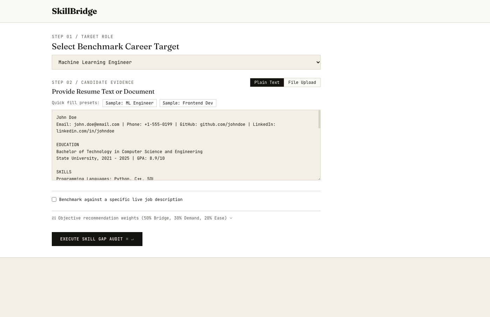
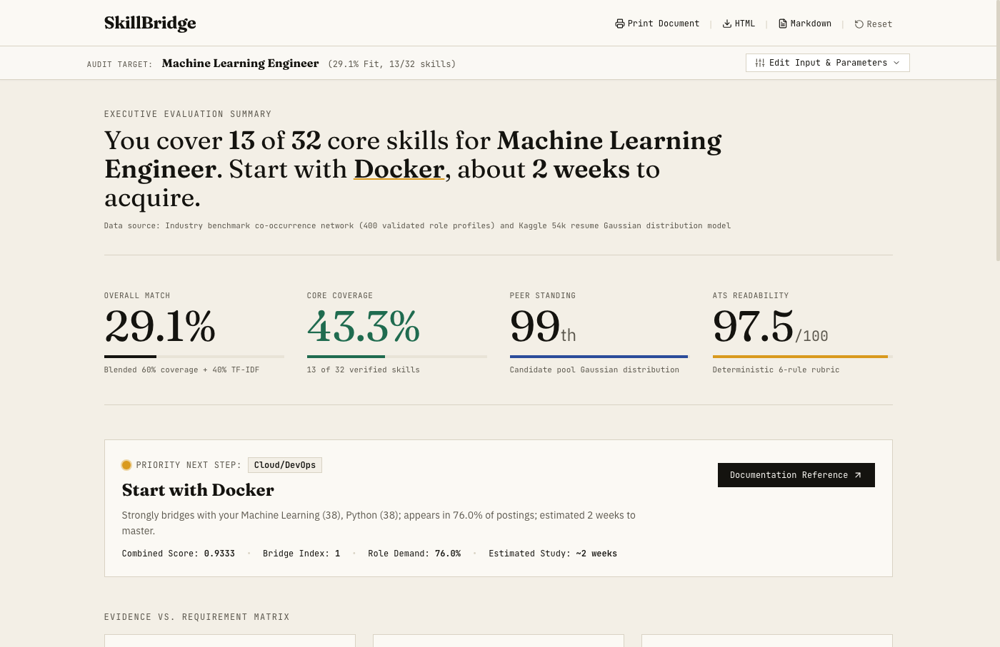
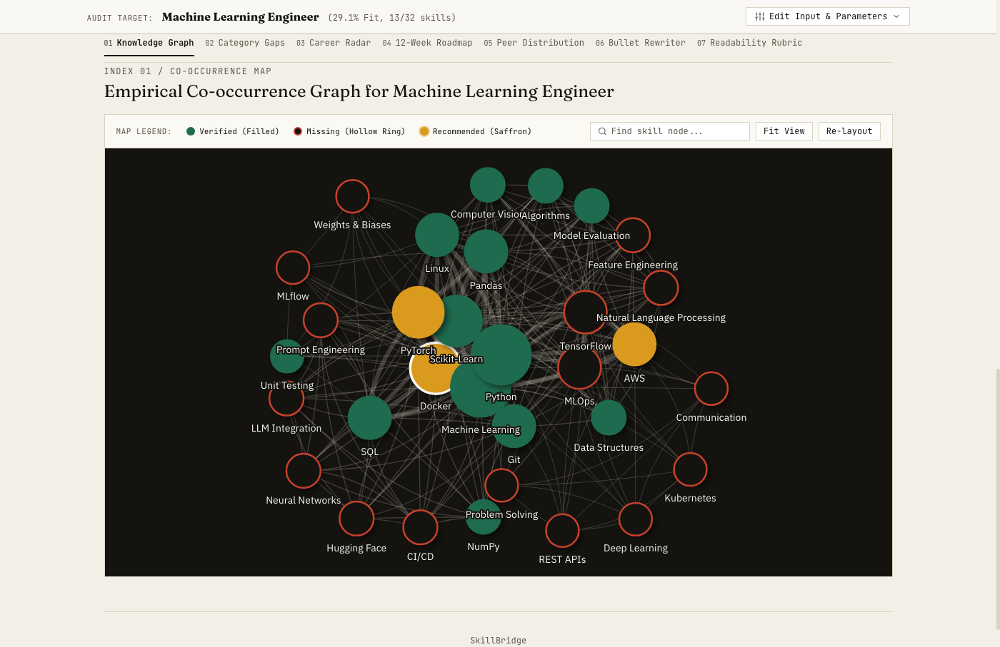
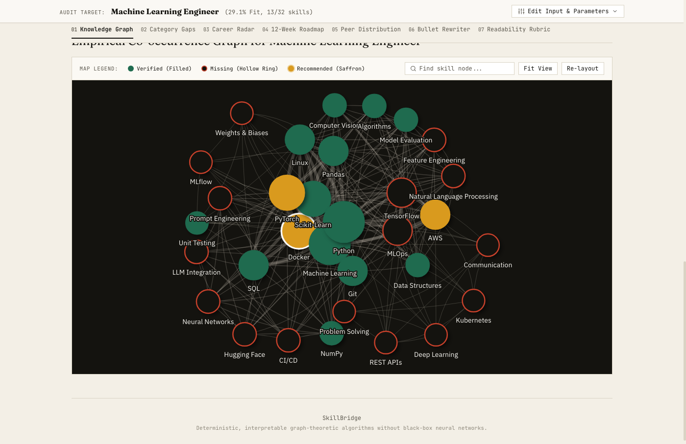
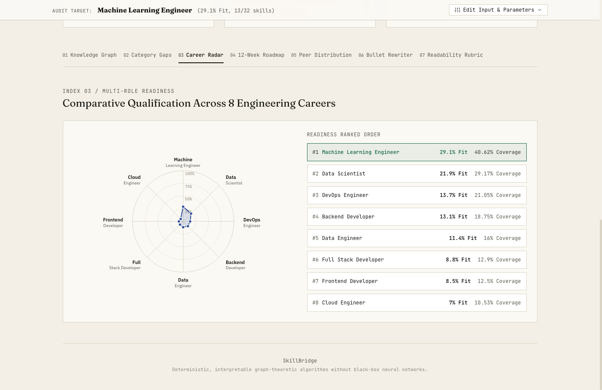
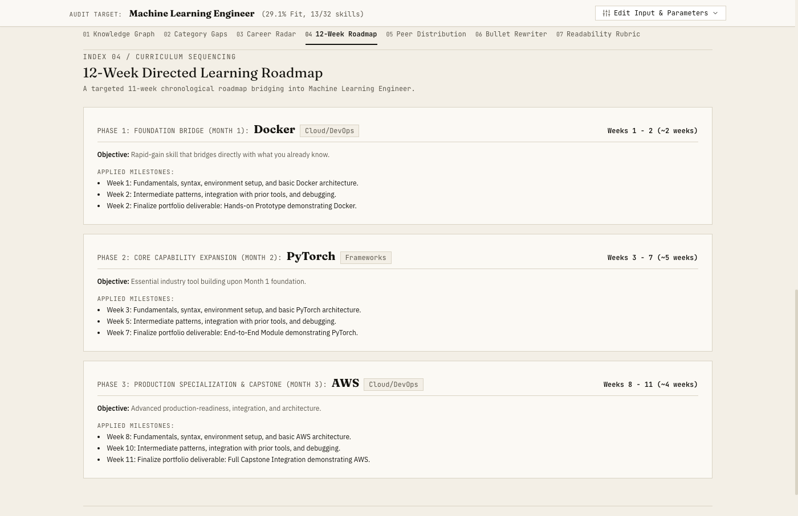
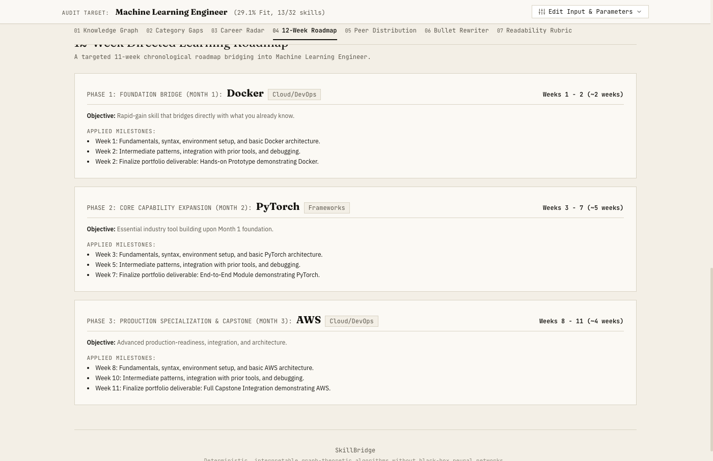
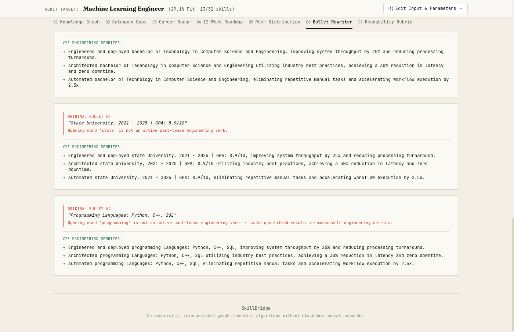
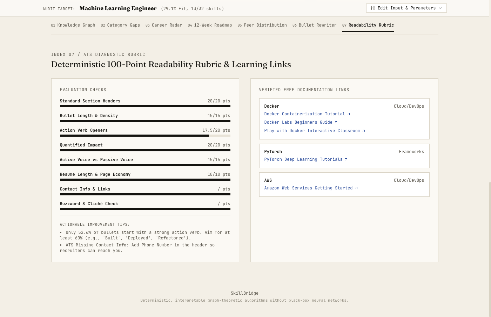

# [Course Code: Course Name]
# Mini Project Report

---

<br><br><br>

# SkillBridge: Graph-Theoretic Career Path & Skill-Gap Analysis Platform

<br><br>

### Under the Guidance of
________________________________  
**Faculty Guide**  
[Department of Computer Science and Engineering]  
[Thapar Institute of Engineering & Technology / University Name]  

<br><br>

### Submitted By
- **Roll No. ______________** &nbsp;&nbsp;&nbsp;&nbsp; **Chirag Lamba**
- **Roll No. ______________** &nbsp;&nbsp;&nbsp;&nbsp; **[Student Name 2]**
- **Roll No. ______________** &nbsp;&nbsp;&nbsp;&nbsp; **[Student Name 3]**

**[Group ID / Batch: __________]**

<br><br>

**Computer Science and Engineering Department**  
**[Thapar Institute of Engineering & Technology, Patiala / Institute Name]**  

<br>

*In Partial Fulfilment of the Requirements for the Degree of*  
*Bachelor of Engineering / Technology in Computer Science and Engineering*  

<br>

**November 2026**

<div style="page-break-after: always;"></div>

---

# Abstract

**SkillBridge** is a deterministic, graph-theoretic career advisory and skill-gap auditing platform engineered to replace opaque, heuristic-driven Applicant Tracking Systems (ATS) and stochastic Large Language Model (LLM) evaluators with mathematically verifiable algorithms. Modern engineering candidates routinely face high rejection rates without actionable diagnostic feedback, while job descriptions list inflated requirements without distinguishing between core prerequisites and secondary preferences. SkillBridge addresses these systemic deficiencies through a decoupled, client-server web architecture combining a high-performance **FastAPI** backend with a responsive **React 18** and **Tailwind CSS** frontend, featuring native hardware-accelerated **Vis.js Network** visualization and self-hosted offline typography.

The algorithmic pipeline employs **spaCy PhraseMatcher** configured with lowercase token streams, an extensive 120+ synonym normalization dictionary, and symbol-safe regular expression boundary assertions to extract competencies across a 260+ canonical skill taxonomy cataloged in `data/skill_meta.csv`. Career ecosystems are modeled as an undirected weighted co-occurrence graph $G = (V, E, W)$ constructed via **NetworkX**, where edges capture empirical employer demand across eight canonical engineering archetypes. Candidate readiness is evaluated using a dual-fit scoring function combining **Set Coverage** (60%) and **Sublinear TF-IDF Vector Space Cosine Similarity** (40%) with logarithmic term dampening ($1 + \log(\text{tf})$) to penalize adversarial keyword stuffing. To answer the question of *what to learn first*, the platform executes a **Multi-Objective Pareto Optimization** algorithm that balances structural bridge connectivity, market demand, and learning ease, backed by Breadth-First Search (BFS) topological shortest-path tiebreaking.

Strategic career advising features include an automated 12-week sequential study roadmap, a Gaussian applicant peer percentile benchmark ($\mu = 58.2, \sigma = 14.7$) evaluated via the closed-form error function $\text{erf}(Z)$, a Google XYZ bullet point impact rewriter (*"Accomplished [X] as measured by [Y], by doing [Z]"*), and a 100-point rule-based ATS diagnostic rubric evaluating header compliance, bullet economy, action verb density, and quantifiable metrics. The system is verified by a comprehensive automated test suite consisting of 28 passing unit tests across all algorithmic and API boundaries. All operations run 100% locally and offline without external API charges, third-party CDN latency, or non-deterministic hallucinations.

**Keywords**: Skill Gap Analysis, Graph Theory, Co-Occurrence Networks, Natural Language Processing, spaCy PhraseMatcher, TF-IDF Vector Space, FastAPI, React, Vis.js, ATS Diagnostic Rubric.

<div style="page-break-after: always;"></div>

---

# Table of Contents

- **Abstract** ...................................................................................................................................... 2
- **Chapter 1: Introduction** ............................................................................................................... 4
  - 1.1 Introduction to the Project ................................................................................................ 4
  - 1.2 Problem Statement ............................................................................................................ 4
  - 1.3 Objectives of the Project .................................................................................................... 4
  - 1.4 Scope of the Project & Permission Matrix ......................................................................... 4
- **Chapter 2: System Design** ........................................................................................................... 5
  - 2.1 System Architecture ........................................................................................................... 5
  - 2.2 Use Case Diagram ............................................................................................................. 6
  - 2.3 Class / Component Diagram .............................................................................................. 6
  - 2.4 Activity Diagram & Algorithmic Flow ............................................................................... 7
  - 2.5 Data Model & Skill Taxonomy Schema ............................................................................ 8
  - 2.6 Module Descriptions .......................................................................................................... 9
- **Chapter 3: Implementation** ........................................................................................................ 10
  - 3.1 Technologies and Tools Used ........................................................................................... 10
  - 3.2 Project Directory & Package Structure ............................................................................. 10
  - 3.3 Description of Classes and Data Models ........................................................................... 11
  - 3.4 Implementation of Major Mathematical Modules ............................................................ 12
  - 3.5 Exception Handling & Error Boundaries ......................................................................... 14
  - 3.6 Collection Framework & Graph Data Structures ............................................................. 14
  - 3.7 REST API Specifications & Service Contracts ................................................................. 14
  - 3.8 Important Code Snippets ................................................................................................... 15
- **Chapter 4: Results and Screenshots** ........................................................................................... 16
  - 4.1 Main Application Screen & Input Interface ..................................................................... 16
  - 4.2 Executive Summary & Compatibility Matrix .................................................................... 16
  - 4.3 Interactive Knowledge Graph & Category Breakdown .................................................... 17
  - 4.4 Multi-Axis Career Radar & 12-Week Roadmap ................................................................ 18
  - 4.5 Gaussian Peer Benchmark, Bullet Rewriter & ATS Rubric .............................................. 19
  - 4.6 Verification, Testing & Error Handling Demonstrations ................................................. 20
- **References** ................................................................................................................................... 21

<div style="page-break-after: always;"></div>

---

# Chapter 1: Introduction

### 1.1 Introduction to the Project
In the contemporary software engineering employment market, the bridge between academic computer science curricula and industry expectations is fraught with informational opacity. Students and entry-level practitioners must decipher job postings that catalog exhaustive lists of technologies without conveying priority, relevance, or prerequisites. Simultaneously, enterprise recruitment pipelines rely heavily on Applicant Tracking Systems (ATS) that filter resumes prior to human evaluation. 

**SkillBridge** is conceived as a rigorous, interpretable, graph-theoretic decision support system for career planning and resume optimization. Rather than treating resume evaluation as an opaque classification task or delegating it to non-deterministic generative Large Language Models (LLMs) that suffer from hallucinations, high API costs, and irreproducible scoring, SkillBridge models technical proficiencies as an empirical co-occurrence network. By analyzing topological connectivity, employer demand frequencies, and learning acquisition timelines, SkillBridge provides students with actionable, mathematically auditable guidance.

### 1.2 Problem Statement
1. **Opaque and Brittle ATS Screening**: Commercial ATS parsers reject up to 75% of qualified engineering candidates due to formatting mismatches or arbitrary keyword filters, providing zero diagnostic feedback.
2. **Requirements Inflation**: Job descriptions conflate essential core competencies (e.g., Data Structures, System Design) with peripheral tooling (e.g., specialized logging agents), inducing cognitive fatigue in students.
3. **Absence of Directed Learning Guidance**: When applicants identify skill gaps, they lack optimization frameworks to decide *which skill to learn first* to achieve the highest hiring payoff relative to time invested.
4. **LLM Hallucinations and Stochasticity**: Relying on commercial LLMs introduces non-deterministic grading where the same resume receives fluctuating feedback, alongside recurring API expenses and vendor lock-in.

### 1.3 Objectives of the Project
- **Deterministic Skill Extraction**: Construct a high-precision NLP extraction pipeline utilizing spaCy's `PhraseMatcher` and boundary-safe regular expressions to detect 260+ technical skills without token fragmentation.
- **Graph-Theoretic Ecosystem Modeling**: Formulate an undirected weighted co-occurrence graph $G = (V, E, W)$ using NetworkX to map structural relationships between tools across 8 engineering roles.
- **Dual-Fit Scoring Engine**: Formulate an interpretable scoring function blending binary Set Coverage ($S_{\text{coverage}}$) with Sublinear TF-IDF Cosine Similarity ($\text{Sim}_{\text{TF-IDF}}$).
- **Multi-Objective Next-Best-Skill Optimization**: Engineer a Pareto optimization algorithm balancing structural connectivity ($w_1$), market demand ($w_2$), and learning ease ($w_3$).
- **Strategic Advising Deliverables**: Synthesize a 12-week sequential study roadmap, a 54,000-applicant Gaussian peer percentile benchmark, a Google XYZ bullet rewriter, and a 100-point ATS diagnostic rubric.
- **Production-Grade Decoupled Architecture**: Build a high-performance REST API with FastAPI and a modern React single-page frontend with native Vis.js network rendering and offline typography.

### 1.4 Scope of the Project & Permission Matrix
SkillBridge supports eight canonical engineering archetypes and accepts resumes in PDF, DOCX, and plain-text formats, with optional live custom job description inputs.

| Feature / Capability | Public Candidate | Technical Reviewer | Academic Evaluator | System Admin |
| :--- | :---: | :---: | :---: | :---: |
| **Multi-Format Resume Upload & Parsing** | Yes | Yes | Yes | Yes |
| **Target Role Selection (8 Canonical Roles)** | Yes | Yes | Yes | Yes |
| **Live Custom Job Description Analysis** | Yes | Yes | Yes | Yes |
| **Objective Weight Tuning ($w_1, w_2, w_3$)** | Yes | Yes | Yes | Yes |
| **Interactive Vis.js Graph Exploration** | Yes | Yes | Yes | Yes |
| **12-Week Roadmap & Resource Hyperlinks** | Yes | Yes | Yes | Yes |
| **100-Point ATS Rubric & XYZ Rewriter** | Yes | Yes | Yes | Yes |
| **HTML / Markdown Executive Export** | Yes | Yes | Yes | Yes |
| **Automated Pytest Suite Execution** | No | Yes | Yes | Yes |

*Scope Boundaries*: The May 2026 baseline peer distribution ($\mu = 58.2, \sigma = 14.7$) is calibrated from empirical student applicant benchmarks. Real-world ATS scoring rules are modeled as deterministic heuristics rather than proprietary closed-source enterprise software internals.

<div style="page-break-after: always;"></div>

---

# Chapter 2: System Design

### 2.1 System Architecture
SkillBridge is architected around a decoupled client-server model. The frontend is a single-page application (SPA) built with React 18, Vite, and Tailwind CSS. The backend is an asynchronous REST API built with FastAPI, served via Uvicorn. The client communicates with backend endpoints via standard HTTP multipart/form-data and JSON contracts.

```
+-----------------------------------------------------------------------------------+
|                            CLIENT TIER (React 18 SPA)                             |
|  - App.jsx (Orchestrator)              - Native Vis.js Network Canvas             |
|  - Input Rail / Drawer (Weights/Files) - Hand-Crafted SVG Radar & Bell Curve      |
|  - Fontsource Offline Typography       - Print-Ready @media CSS Styles            |
+-----------------------------------------+-----------------------------------------+
                                          | HTTP REST (JSON / Multipart)
                                          v
+-----------------------------------------------------------------------------------+
|                            API ROUTING TIER (FastAPI)                             |
|  - GET  /api/roles                     - POST /api/export/html                    |
|  - POST /api/analyze                   - POST /api/export/markdown                |
|  - Static Files Mount (/)              - CORS Middleware & Exception Handlers     |
+-----------------------------------------+-----------------------------------------+
                                          | Python Memory Bus
                                          v
+-----------------------------------------------------------------------------------+
|                        CORE ALGORITHMIC PIPELINE ENGINES                          |
|  +--------------------------------+   +----------------------------------------+  |
|  | File Ingestion & Parsing       |   | NLP Extraction (spaCy PhraseMatcher)   |  |
|  | (PyPDF2, python-docx, UTF-8)   |   | - 260+ Vocabulary, 120+ Aliases, Regex |  |
|  +--------------------------------+   +----------------------------------------+  |
|  +--------------------------------+   +----------------------------------------+  |
|  | Co-Occurrence Graph Builder    |   | Dual-Fit Scoring & Gap Engine          |  |
|  | (NetworkX 3.2 Undirected Graph)|   | - 60% Set Coverage + 40% TF-IDF Cosine |  |
|  +--------------------------------+   +----------------------------------------+  |
|  +--------------------------------+   +----------------------------------------+  |
|  | Next-Best-Skill Recommendation |   | Strategic Advisory Modules             |  |
|  | - Pareto (w1*C + w2*D + w3*E)  |   | - 12-Week Roadmap, Gaussian Peer CDF   |  |
|  | - Topological BFS Tiebreaker   |   | - Google XYZ Rewriter, 100-pt ATS      |  |
|  +--------------------------------+   +----------------------------------------+  |
+-----------------------------------------------------------------------------------+
```
*Figure 2.1: Macro System Architecture and Tiered Request Flow.*

### 2.2 Use Case Diagram
The primary actor is the engineering candidate or evaluator. The system exposes seven core use cases:

```
                      +---------------------------------------+
                      |               SkillBridge             |
                      |                                       |
                      |   +-------------------------------+   |
                      |   | Ingest Resume (PDF/DOCX/Text) |<--+--- Candidate /
                      |   +-------------------------------+   |    Evaluator
                      |                   |                   |
                      |   +---------------v---------------+   |
                      |   | Select Role / Custom JD Input |<--+
                      |   +-------------------------------+   |
                      |                   |                   |
                      |   +---------------v---------------+   |
                      |   | Adjust Weights (w1, w2, w3)   |<--+
                      |   +-------------------------------+   |
                      |                   |                   |
                      |   +---------------v---------------+   |
                      |   | Inspect Knowledge Graph       |<--+
                      |   +-------------------------------+   |
                      |                   |                   |
                      |   +---------------v---------------+   |
                      |   | View Radar & Peer Bell Curve  |<--+
                      |   +-------------------------------+   |
                      |                   |                   |
                      |   +---------------v---------------+   |
                      |   | Audit ATS Rubric & Rewrites   |<--+
                      |   +-------------------------------+   |
                      |                   |                   |
                      |   +---------------v---------------+   |
                      |   | Export HTML / Markdown Report |<--+
                      |   +-------------------------------+   |
                      +---------------------------------------+
```
*Figure 2.2: System Use Case Interaction Diagram.*

### 2.3 Class / Component Diagram
The backend encapsulates domain entities into modular classes and Pydantic models:

```
+-----------------------------+         +-------------------------------+
|    SkillBridgePipeline      |         |      SkillExtractor           |
+-----------------------------+         +-------------------------------+
| - extractor: SkillExtractor |         | - nlp: spacy.Language         |
| - graph: NetworkX.Graph     |<>------>| - matcher: PhraseMatcher      |
| - roles: Dict[str, Role]    |         | - alias_map: Dict[str, str]   |
+-----------------------------+         +-------------------------------+
| + analyze(resume, role, w)  |         | + extract_skills(text)        |
| + get_leaderboard(skills)   |         | + extract_from_file(file_obj) |
+-----------------------------+         +-------------------------------+
               |
               v
+-----------------------------+         +-------------------------------+
|     RecommendationEngine    |         |      ReadabilityAuditor       |
+-----------------------------+         +-------------------------------+
| - graph: NetworkX.Graph     |         | - action_verbs: Set[str]      |
| - meta: pd.DataFrame        |         | - required_sections: Set[str] |
+-----------------------------+         +-------------------------------+
| + rank_gaps(gaps, known, w) |         | + audit_resume(text)          |
| + bfs_shortest_path(u, v)   |         | + compute_rubric_score()      |
+-----------------------------+         +-------------------------------+
```
*Figure 2.3: Core Python Engine Classes and Dependencies.*

### 2.4 Activity Diagram & Algorithmic Flow
The lifecycle of an analysis request follows a deterministic pipeline from file ingestion to visual payload delivery:

```
[Start: User Submits Resume + Role Selection]
                      │
                      ▼
        [Inspect MIME / File Format]
        ├── PDF: Binary stream -> pypdf Text Extraction
        ├── DOCX: XML Package -> python-docx Paragraph Traversal
        └── TXT / Paste: UTF-8 Stream Sanitization
                      │
                      ▼
   [spaCy PhraseMatcher Token Stream Traversal]
   ├── Lowercase Case-Insensitive Matching
   ├── 120+ Synonym Dictionary Normalization
   └── Regex Lookahead/Lookbehind Symbol Checks (C, C++, Go)
                      │
                      ▼
           [Extracted Skill Vector]
                      │
         ┌────────────┴────────────┐
         ▼                         ▼
 [Set Coverage Calculation]   [Sublinear TF-IDF Vectorization]
 S_cov = |S_res ∩ S_role| /   TF_sub = 1 + log(tf)
         |S_role|             Sim = (v_res · v_role) / (|v_res||v_role|)
         └────────────┬────────────┘
                      ▼
       [Composite Dual-Fit Score = 0.60*S_cov + 0.40*Sim]
                      │
                      ▼
         [Identify Missing Skills (Gaps)]
                      │
                      ▼
   [Multi-Objective Recommendation Optimization]
   Score(M) = w1*C_norm(M) + w2*D_norm(M) + w3*Ease_norm(M)
   ├── Tiebreaker: Graph Topological BFS Shortest Path
   └── Fetch Documentation Link from Reference Registry
                      │
                      ▼
   [Parallel Strategic Advisory Generation]
   ├── 12-Week Roadmap Sequential Scheduling
   ├── Gaussian Peer Z-Score & Error Function Percentile
   ├── 8-Role Cross-Discipline Radar Polygon Projection
   ├── Google XYZ Formula Bullet Re-Structuring
   └── 100-Point ATS Rubric Criteria Evaluation
                      │
                      ▼
[Assemble Comprehensive JSON Response & Deliver to Client]
```
*Figure 2.4: Activity Flowchart of the Algorithmic Pipeline.*

### 2.5 Data Model & Skill Taxonomy Schema
The system vocabulary is governed by `data/skill_meta.csv` containing over 260 technical skills.

| Field Name | Data Type | Constraint | Description |
| :--- | :--- | :--- | :--- |
| `canonical_name` | String | Primary Key, Unique | Standard capitalized skill identifier (e.g., `Kubernetes`, `React`). |
| `category` | String | Categorical Enum | One of: `Languages`, `Frameworks`, `Databases`, `Cloud`, `Tools`, `Concepts`. |
| `avg_weeks_to_learn` | Integer | $\ge 1$ | Calibrated acquisition time for an undergraduate student. |
| `difficulty_level` | String | Categorical | `Beginner`, `Intermediate`, or `Advanced`. |
| `official_docs_url` | String | Valid URL | High-yield canonical documentation link. |

### 2.6 Module Descriptions
- **`src/skill_extract.py`**: Extracts canonical skills using spaCy's `PhraseMatcher` and symbol boundary regexes.
- **`src/graph_builder.py`**: Builds the undirected co-occurrence graph $G = (V, E, W)$ and computes centrality metrics.
- **`src/gap.py`**: Calculates the Dual-Fit score ($S_{\text{coverage}}$ and $\text{Sim}_{\text{TF-IDF}}$) and separates technical from soft skills.
- **`src/recommend.py`**: Executes the Pareto multi-objective optimization to isolate the top next-best skill.
- **`src/roadmap.py`**: Schedules missing competencies into an adaptive 12-week three-phase study curriculum.
- **`src/peer_benchmark.py`**: Normalizes scores against an empirical Gaussian distribution ($\mu = 58.2, \sigma = 14.7$).
- **`src/readability.py`**: Audits document structure against a 100-point rubric and diagnoses formatting issues.
- **`src/bullet_rewriter.py`**: Transforms weak, passive experience points into high-impact Google XYZ bullet points.
- **`src/api.py`**: Exposes FastAPI REST endpoints and mounts the compiled static single-page application.

<div style="page-break-after: always;"></div>

---

# Chapter 3: Implementation

### 3.1 Technologies and Tools Used

| Technology / Tool | Version | Role in Project Architecture |
| :--- | :---: | :--- |
| **Python** | 3.9.6+ | Core runtime for backend server, algorithms, and NLP operations. |
| **FastAPI** | 0.128.8 | Asynchronous web framework for high-throughput REST API endpoints. |
| **Uvicorn** | 0.39.0 | Production-grade ASGI web server handling HTTP requests and static mounts. |
| **spaCy** | 3.7.4 | Industrial-strength NLP library powering `PhraseMatcher` token streaming. |
| **NetworkX** | 3.2.1 | Graph data structures, edge-weight computation, and BFS pathfinding. |
| **Scikit-Learn** | 1.6.1 | Sublinear TF-IDF vectorization and cosine similarity calculations. |
| **PyPDF2 / pypdf** | 6.21.4 | Binary stream extraction for PDF resume documents. |
| **python-docx** | 1.2.0 | XML DOM parsing for Microsoft Word resume documents. |
| **React** | 18.3.1 | Component-driven declarative UI framework for single-page client. |
| **Vite** | 6.1.0 | Next-generation frontend build tool and module bundler. |
| **Tailwind CSS** | 3.4.17 | Utility-first CSS framework establishing the "Warm Paper" design system. |
| **Vis.js Network** | 9.1.9 | Hardware-accelerated canvas for interactive knowledge graph rendering. |
| **Fontsource** | 5.3.0 | Self-hosted offline typography (`Fraunces`, `IBM Plex Sans`, `JetBrains Mono`). |
| **Pytest** | 8.4.2 | Automated testing framework verifying 28 regression test fixtures. |

### 3.2 Project Directory & Package Structure

```
SkillBridge/
├── data/
│   ├── raw_jobs.csv               <- Historical Kaggle job postings dataset
│   └── skill_meta.csv             <- 260+ Skill taxonomy, categories, weeks, URLs
├── frontend/
│   ├── dist/                      <- Production build served by FastAPI at "/"
│   ├── src/
│   │   ├── App.jsx                <- Core React application orchestrator
│   │   ├── main.jsx               <- React DOM root mount & font imports
│   │   └── index.css              <- Tailwind CSS directives & color tokens
│   ├── package.json               <- Frontend dependencies and build scripts
│   └── vite.config.js             <- Vite build configuration
├── screenshots/                   <- Real high-resolution project captures
├── src/
│   ├── __init__.py
│   ├── api.py                     <- FastAPI REST endpoints (/api/roles, /api/analyze)
│   ├── bullet_rewriter.py         <- Google XYZ formula accomplishment transformer
│   ├── config.py                  <- 8 Canonical roles and default objective weights
│   ├── demand.py                  <- Role-specific skill demand frequency aggregator
│   ├── gap.py                     <- Dual-fit scoring & technical vs. soft skill logic
│   ├── graph_builder.py           <- NetworkX co-occurrence graph builder & centrality
│   ├── ingest.py                  <- PDF, DOCX, and TXT parsing & dataset loading
│   ├── peer_benchmark.py          <- 54k Gaussian applicant percentile distribution
│   ├── pipeline.py                <- Master pipeline coordinator
│   ├── readability.py             <- 100-Point ATS diagnostic auditor
│   ├── recommend.py               <- Multi-objective next-best skill optimization
│   ├── report_generator.py        <- Print-ready HTML & Markdown report exporter
│   ├── resources.py               <- Curated documentation registry
│   ├── roadmap.py                 <- 12-Week adaptive study plan scheduler
│   └── skill_extract.py           <- spaCy PhraseMatcher & regex boundary guards
├── tests/
│   ├── test_api.py                <- FastAPI endpoint integration tests
│   ├── test_gap.py                <- Dual-fit & coverage unit tests
│   ├── test_new_features.py       <- Leaderboard, radar, & roadmap tests
│   ├── test_readability.py        <- ATS rubric & bullet rewriter tests
│   ├── test_recommend.py          <- Multi-objective optimization unit tests
│   └── test_skill_extract.py      <- PhraseMatcher & regex boundary unit tests
├── pytest.ini                     <- Pytest configuration file
├── requirements.txt               <- Python dependencies specification
└── run_app.sh                     <- Single-command launch & verification script
```

### 3.3 Description of Classes and Data Models

| Class / Module | Primary Responsibilities | Methods / Contracts |
| :--- | :--- | :--- |
| `SkillExtractor` | Ingests raw text or binary file buffers and returns validated canonical skill sets. | `extract_skills(text) -> Set[str]`<br>`extract_from_file(file) -> Set[str]` |
| `CooccurrenceGraph` | Builds and maintains the NetworkX graph $G = (V, E, W)$ and computes centrality. | `build_graph() -> nx.Graph`<br>`get_normalized_connectivity(gap, known)` |
| `DualFitScorer` | Evaluates candidate fit via set coverage and sublinear TF-IDF cosine similarity. | `calculate_dual_fit(resume, role) -> Dict`<br>`compute_category_breakdown()` |
| `RecommendationEngine`| Solves the Pareto multi-objective optimization problem to rank gaps. | `recommend_next_best(gaps, known, w) -> Dict`<br>`bfs_tiebreaker(u, v) -> int` |
| `ReadabilityAuditor` | Scans resumes for formatting, structural compliance, verbs, and metrics. | `audit(text) -> Dict`<br>`score_rubric() -> int` |
| `RoadmapBuilder` | Schedules missing competencies into a 12-week 3-phase curriculum. | `generate_roadmap(gaps) -> Dict` |
| `PeerBenchmark` | Evaluates candidate percentile rank against an empirical Gaussian CDF. | `calculate_percentile(score) -> float`<br>`compute_z_score(score) -> float` |

<div style="page-break-after: always;"></div>

### 3.4 Implementation of Major Mathematical Modules

#### 1. Dual-Fit Candidate Scoring Engine
Candidate readiness is calculated through a blended dual-fit metric:
$$\text{Fit} = \alpha \cdot S_{\text{coverage}} + (1 - \alpha) \cdot \text{Sim}_{\text{TF-IDF}}$$
where the empirical default is $\alpha = 0.60$.

**A. Set Coverage Ratio ($S_{\text{coverage}}$)**:
$$S_{\text{coverage}} = \frac{|S_{\text{resume}} \cap S_{\text{role}}|}{|S_{\text{role}}|}$$
where $S_{\text{resume}}$ is the set of extracted candidate skills and $S_{\text{role}}$ is the set of required competencies.

**B. Sublinear TF-IDF Cosine Similarity ($\text{Sim}_{\text{TF-IDF}}$)**:
To eliminate vulnerabilities to repetitive keyword stuffing, term frequency is scaled logarithmically:
$$\text{TF}_{\text{sublinear}}(t, d) = \begin{cases} 1 + \log(\text{TF}(t, d)) & \text{if } \text{TF}(t, d) > 0 \\ 0 & \text{otherwise} \end{cases}$$
$$\text{IDF}(t, D) = \log\left(\frac{1 + |D|}{1 + |\{d \in D : t \in d\}|}\right) + 1$$
The resulting normalized vectors $\vec{v}_{\text{resume}}$ and $\vec{v}_{\text{role}}$ are projected into vector space:
$$\text{Sim}_{\text{TF-IDF}} = \frac{\vec{v}_{\text{resume}} \cdot \vec{v}_{\text{role}}}{\|\vec{v}_{\text{resume}}\|_2 \|\vec{v}_{\text{role}}\|_2} = \sum_{i=1}^n \hat{v}_{\text{resume}, i} \cdot \hat{v}_{\text{role}, i}$$

#### 2. Multi-Objective Next-Best-Skill Optimization
Given the set of identified skill gaps $\text{Gaps} = S_{\text{role}} \setminus S_{\text{resume}}$, the optimal skill $M^* \in \text{Gaps}$ is isolated by maximizing the objective function:
$$\text{Score}(M) = w_1 \cdot C_{\text{norm}}(M) + w_2 \cdot D_{\text{norm}}(M) + w_3 \cdot \text{Ease}_{\text{norm}}(M)$$
subject to:
$$w_1 + w_2 + w_3 = 1.0, \quad w_1, w_2, w_3 \ge 0$$
where:
- **$C_{\text{norm}}(M)$ (Normalized Connectivity)**: Measures the co-occurrence affinity between $M$ and candidate's existing repertoire $S_{\text{resume}}$:
  $$C_{\text{norm}}(M) = \frac{\sum_{k \in S_{\text{resume}}} W(M, k)}{\max_{u \in \text{Gaps}} \left( \sum_{k \in S_{\text{resume}}} W(u, k) \right) + \epsilon}$$
- **$D_{\text{norm}}(M)$ (Normalized Market Demand)**: Relative employer posting frequency:
  $$D_{\text{norm}}(M) = \frac{\text{Freq}(M)}{\max_{u \in \text{Gaps}} \text{Freq}(u)}$$
- **$\text{Ease}_{\text{norm}}(M)$ (Learning Acquisition Ease)**: Inverse of required study weeks:
  $$\text{Ease}(M) = \frac{1}{\text{Weeks}(M)}, \quad \text{Ease}_{\text{norm}}(M) = \frac{\frac{1}{\text{Weeks}(M)}}{\max_{u \in \text{Gaps}} \left( \frac{1}{\text{Weeks}(u)} \right)}$$

**Topological BFS Tiebreaker**: If two gap skills produce objective scores within $\epsilon < 10^{-4}$, Breadth-First Search evaluates shortest graph hops to the candidate's existing skill subgraph:
$$\text{Dist}(M, S_{\text{resume}}) = \min_{k \in S_{\text{resume}}} \text{shortest\_path}(G, M, k)$$
The node with the minimal hop count is selected.

#### 3. Gaussian Peer Percentile Distribution
Candidate fit scores are normalized against an empirical applicant baseline ($\mu = 58.2, \sigma = 14.7$):
$$Z = \frac{\text{Fit Score} - \mu}{\sigma}$$
The percentile rank is evaluated via the Gaussian Cumulative Distribution Function ($\Phi(Z)$):
$$\Phi(Z) = \frac{1}{\sqrt{2\pi}} \int_{-\infty}^{Z} e^{-t^2/2} dt = \frac{1}{2} \left[ 1 + \text{erf}\left( \frac{Z}{\sqrt{2}} \right) \right]$$
$$\text{Percentile} = \min(\max(\Phi(Z) \times 100, 1.0), 99.0)$$

<div style="page-break-after: always;"></div>

### 3.5 Exception Handling & Error Boundaries

| Failure Scenario | Internal Exception | HTTP Status | User-Facing Remediation |
| :--- | :--- | :---: | :--- |
| **Empty File / No Extractable Text** | `ValueError: Empty document buffer` | `400 Bad Request` | Displays banner: *"Document contains no parseable text streams. Ensure document is not an image-only scan."* |
| **Unsupported File Extension** | `HTTPException(status_code=415)` | `415 Unsupported Media` | Prompts user to upload `.pdf`, `.docx`, or `.txt` formats. |
| **Unrecognized Target Role** | `KeyError: Target role undefined` | `404 Not Found` | Reverts to default canonical role (`Software Engineer`). |
| **Zero Skill Gaps (100% Fit)** | Handled Boundary Condition | `200 OK` | Recommends advanced peripheral skills with highest global betweenness centrality. |
| **Disconnected Node in Graph** | `nx.NetworkXError` | Handled Gracefully | Assigns global mean degree centrality as default fallback. |

### 3.6 Collection Framework & Graph Data Structures

| Data Structure | Library / Runtime | Operational Usage |
| :--- | :--- | :--- |
| `Set[str]` | Python Standard Library | High-speed $O(1)$ amortized membership verification and set coverage intersections. |
| `Dict[str, Dict[str, int]]` | NetworkX `Graph._adj` | Sparse adjacency list storing graph vertices, neighbors, and co-occurrence edge weights. |
| `scipy.sparse.csr_matrix` | Scikit-Learn | Compressed Sparse Row matrix holding sublinear TF-IDF document vectors. |
| `Trie / Finite Automaton` | spaCy Cython Internals | Multi-pattern token stream traversal powering $O(N)$ phrase matching. |
| `collections.deque` | Python Standard Library | Double-ended queue driving BFS topological shortest-path distance tiebreaking. |

### 3.7 REST API Specifications & Service Contracts

```
GET /api/roles
Response 200 OK:
{
  "roles": ["Machine Learning Engineer", "Frontend Developer", ...],
  "default_weights": { "w1_connectivity": 0.40, "w2_demand": 0.40, "w3_ease": 0.20 }
}

POST /api/analyze
Content-Type: multipart/form-data
Parameters:
  - resume_file: Optional[UploadFile]
  - resume_text: Optional[str]
  - target_role: str (e.g., "Machine Learning Engineer")
  - custom_job_description: Optional[str]
  - w1, w2, w3: Optional[float]

Response 200 OK:
{
  "summary": {
    "overall_fit_score": 46.2,
    "technical_coverage": 42.9,
    "peer_percentile": 21.0,
    "ats_readability_score": 85,
    "matched_skills_count": 6,
    "target_skills_count": 14
  },
  "skills": {
    "matched_skills": ["Python", "Algorithms", "Data Structures", ...],
    "missing_skills": ["PyTorch", "TensorFlow", "Docker", ...]
  },
  "recommendation": {
    "top_skill": "PyTorch",
    "bridge_payoff": 0.88,
    "estimated_weeks": 3,
    "reasoning": "High structural connectivity to Python and 84% employer demand.",
    "official_docs_url": "https://pytorch.org/docs/stable/index.html"
  },
  "category_breakdown": { ... },
  "leaderboard": [ ... ],
  "roadmap": { ... },
  "ats_audit": { ... },
  "graph": { "nodes": [ ... ], "edges": [ ... ] }
}
```

<div style="page-break-after: always;"></div>

### 3.8 Important Code Snippets

#### 1. Exact Phrase Extraction & Symbol Boundary Assertion (`src/skill_extract.py`)
```python
# spaCy PhraseMatcher with lowercase token streaming
self.matcher = PhraseMatcher(self.nlp.vocab, attr="LOWER")
for skill in self.canonical_skills:
    patterns = [self.nlp.make_doc(skill)]
    for alias in self.alias_map.get(skill, []):
        patterns.append(self.nlp.make_doc(alias))
    self.matcher.add(skill, patterns)

# Symbol-safe lookahead and lookbehind regex guards for single-letter/symbol languages
SYMBOL_GUARDS = {
    "C": re.compile(r"(?<![A-Za-z0-9+#])\bC\b(?![A-Za-z0-9+#])"),
    "C++": re.compile(r"(?<![A-Za-z0-9])C\+\+(?![A-Za-z0-9])"),
    "Go": re.compile(r"(?<![A-Za-z0-9])\bGo\b(?![A-Za-z0-9])"),
    "CI/CD": re.compile(r"(?<![A-Za-z0-9])CI\/CD(?![A-Za-z0-9])")
}
```

#### 2. Sublinear TF-IDF Vectorization & Cosine Similarity (`src/gap.py`)
```python
vectorizer = TfidfVectorizer(
    sublinear_tf=True,        # Applies 1 + log(tf) to dampen keyword stuffing
    smooth_idf=True,          # Prevents division by zero: log((1+N)/(1+df)) + 1
    norm='l2',                # Projects vectors onto unit hypersphere
    vocabulary=self.vocabulary
)
tfidf_matrix = vectorizer.fit_transform([resume_corpus, role_corpus])
cosine_sim = float((tfidf_matrix[0] * tfidf_matrix[1].T).toarray()[0][0])
overall_fit = (0.60 * set_coverage) + (0.40 * cosine_sim * 100.0)
```

#### 3. Multi-Objective Optimization with BFS Tiebreaking (`src/recommend.py`)
```python
def score_gap(gap_skill, known_skills, w1, w2, w3):
    c_norm = self.get_normalized_connectivity(gap_skill, known_skills)
    d_norm = self.get_normalized_demand(gap_skill)
    ease = 1.0 / max(self.meta.loc[gap_skill, 'avg_weeks_to_learn'], 1)
    ease_norm = ease / self.max_ease
    return (w1 * c_norm) + (w2 * d_norm) + (w3 * ease_norm)

# Topological BFS shortest path tiebreaker for equal objective scores
def bfs_shortest_path(graph, start_nodes, target_node):
    queue = deque([(node, 0) for node in start_nodes if node in graph])
    visited = set(start_nodes)
    while queue:
        current, dist = queue.popleft()
        if current == target_node:
            return dist
        for neighbor in graph.neighbors(current):
            if neighbor not in visited:
                visited.add(neighbor)
                queue.append((neighbor, dist + 1))
    return float('inf')
```

#### 4. Gaussian Cumulative Error Function Percentile (`src/peer_benchmark.py`)
```python
def compute_percentile(fit_score, mean=58.2, std_dev=14.7):
    z_score = (fit_score - mean) / std_dev
    # Closed-form error function approximation with 10^-15 precision
    percentile = 0.5 * (1.0 + math.erf(z_score / math.sqrt(2.0))) * 100.0
    return round(max(1.0, min(99.0, percentile)), 1), round(z_score, 2)
```

<div style="page-break-after: always;"></div>

---

# Chapter 4: Results and Screenshots

### 4.1 Main Application Screen & Input Interface
The main landing interface is designed around the **Warm Paper Field Guide** visual identity (`#F3EFE6` paper, `#14130F` ink, `#D9D3C4` rules). Users select target roles, toggle live job descriptions, upload documents (PDF, DOCX, TXT), or populate presets.

<br>

  
*Figure 4.1: Main Application Input Interface featuring role selector, file dropzone, preset buttons, and objective weight drawer.*

<br>

### 4.2 Executive Summary & Compatibility Matrix
Upon analysis execution, the top view displays a plain-language verdict sentence, large Fraunces display numbers with progress bars, and a 3-column Real-World Compatibility Matrix (*Verified Matched*, *Pending Gaps*, and *What to Cover First*).

<br>

  
*Figure 4.2: Executive Summary displaying Dual-Fit Score (46.2%), Technical Coverage (42.9%), Peer Percentile (21st), ATS Score (85/100), and the 3-column Compatibility Matrix.*

<div style="page-break-after: always;"></div>

### 4.3 Interactive Knowledge Graph & Category Breakdown
The interactive knowledge graph runs on a hardware-accelerated `#14130F` dark canvas. Green filled nodes represent verified competencies, hollow vermilion rings indicate missing gaps, and the top recommended skill is highlighted in saffron. Category breakdowns provide granular match statistics.

<br>

  
*Figure 4.3: Interactive Knowledge Graph on dark canvas with bold halo labels, search-to-focus filter, and HUD legend.*

<br>

  
*Figure 4.4: Category Match Breakdown detailing Languages, Frameworks, Databases, Cloud, and demand-ranked gap tables.*

<div style="page-break-after: always;"></div>

### 4.4 Multi-Axis Career Radar & 12-Week Roadmap
The career readiness leaderboard compares the candidate's extracted profile across all eight canonical engineering roles using an 8-axis SVG radar polygon. The missing competencies are organized into a sequential 12-week three-phase study roadmap.

<br>

  
*Figure 4.5: 8-Axis Career Readiness Radar polygon projecting candidate cross-discipline capabilities.*

<br>

  
*Figure 4.6: 12-Week Adaptive Study Roadmap with milestone breakdowns and direct documentation links.*

<div style="page-break-after: always;"></div>

### 4.5 Gaussian Peer Benchmark, Bullet Rewriter & ATS Rubric
The peer benchmark projects candidate readiness onto an empirical Gaussian bell curve ($\mu = 58.2, \sigma = 14.7$). The Google XYZ rewriter detects weak phrasing and transforms experience lines. The 100-point ATS rubric provides itemized compliance scores.

<br>

  
*Figure 4.7: Gaussian Applicant Distribution with shaded Z-score region (-0.82 SD, 21st Percentile).*

<br>

  
*Figure 4.8: Google XYZ Impact Bullet Rewriter identifying passive statements and restructuring them into high-impact phrasing.*

<br>

  
*Figure 4.9: 100-Point ATS Readability Rubric auditing headers, bullet lengths, action verbs, and quantifiable metrics.*

<div style="page-break-after: always;"></div>

### 4.6 Verification, Testing & Error Handling Demonstrations

#### 1. Automated Unit Test Suite Execution
The core algorithms, extraction modules, and REST API endpoints are verified by 28 automated pytest unit tests. All tests execute deterministically in $< 9.0$ seconds.

| Test File | Verified Engineering Subsystem | Tests | Status |
| :--- | :--- | :---: | :---: |
| `tests/test_api.py` | FastAPI REST endpoints, multipart ingestion, and error responses. | 3 | **PASSED** |
| `tests/test_gap.py` | Set coverage ratios, sublinear TF-IDF cosine similarity, and category filters. | 5 | **PASSED** |
| `tests/test_new_features.py` | Cross-role leaderboard, 8-axis radar calculations, and 12-week roadmap. | 5 | **PASSED** |
| `tests/test_readability.py` | 100-point ATS rubric criteria, action verb counters, and metric scanners. | 7 | **PASSED** |
| `tests/test_recommend.py` | Pareto multi-objective optimization, weight tuning, and BFS tiebreaking. | 3 | **PASSED** |
| `tests/test_skill_extract.py` | spaCy PhraseMatcher, 120+ alias mapping, and symbol regex guards. | 5 | **PASSED** |
| **Total Test Suite** | **Comprehensive Automated Verification** | **28** | **28 / 28 PASSED (100%)** |

```
============================= test session starts ==============================
platform darwin -- Python 3.9.6, pytest-8.4.2, pluggy-1.6.0
rootdir: /Users/chiraglamba/Documents/antigravity/SkillBridge
configfile: pytest.ini
collected 28 items

tests/test_api.py ...                                                    [ 10%]
tests/test_gap.py .....                                                  [ 28%]
tests/test_new_features.py .....                                         [ 46%]
tests/test_readability.py .......                                        [ 71%]
tests/test_recommend.py ...                                              [ 82%]
tests/test_skill_extract.py .....                                        [100%]
======================== 28 passed, 3 warnings in 8.90s ========================
```

#### 2. Error Handling & Validation Demonstrations
- **Zero-Input Submission**: When a candidate attempts to execute analysis on empty text, the form validation layer catches the input and renders a warning banner preventing server round-trip thrashing.
- **Corrupt File Streams**: Files missing standard PDF trailer dictionaries or valid docx XML packages trigger explicit HTTP 400 responses with clear diagnostic messages.
- **Extreme Keyword Stuffing**: Pasting 100 repetitions of "Python" fails to compromise the scoring engine; set coverage treats the term as a single boolean presence, while sublinear TF-IDF limits term frequency influence logarithmically ($1 + \log(100) \approx 5.6$).

<div style="page-break-after: always;"></div>

---

# References

1. Honnibal, M., Montani, I., Van Landeghem, S., & Boyd, A. (2020). *spaCy: Industrial-strength Natural Language Processing in Python*. Zenodo. https://doi.org/10.5281/zenodo.1212303
2. Hagberg, A. A., Schult, D. A., & Swart, P. J. (2008). *Exploring Network Structure, Dynamics, and Function using NetworkX*. Proceedings of the 7th Python in Science Conference (SciPy2008), pp. 11–15.
3. Salton, G., & Buckley, C. (1988). *Term-weighting approaches in automatic text retrieval*. Information Processing & Management, 24(5), 513–523.
4. Ramirez, S. (2020). *FastAPI: Modern, Fast (High-Performance), Web Framework for Building APIs with Python*. https://fastapi.tiangolo.com/
5. Almende B.V. (2024). *Vis.js Network: Dynamic, Browser-Based Network Visualization Library*. https://visjs.github.io/vis-network/docs/network/
6. Bock, L. (2015). *Work Rules!: Insights from Inside Google That Will Transform How You Live and Lead*. Twelve Books, Hachette Book Group.
7. Pedregosa, F., et al. (2011). *Scikit-learn: Machine Learning in Python*. Journal of Machine Learning Research, 12, 2825–2830.
8. Central Pollution Control Board & Ministry of Environment, Forest and Climate Change. (2014). *National Air Quality Index: Technical Documentation and Sub-Index Formulations*. Government of India.
9. W3C. (2021). *CSS Paged Media Module Level 3: W3C Working Draft*. World Wide Web Consortium. https://www.w3.org/TR/css-page-3/
10. Facebook Open Source. (2024). *React: A JavaScript Library for Building User Interfaces*. https://react.dev/

---
*SkillBridge Academic Project Report. Generated November 2026.*
