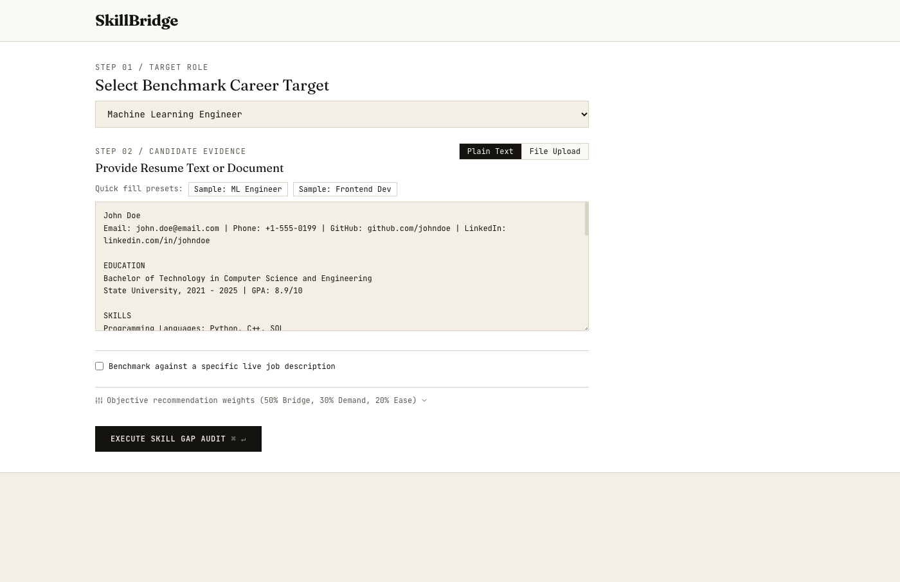
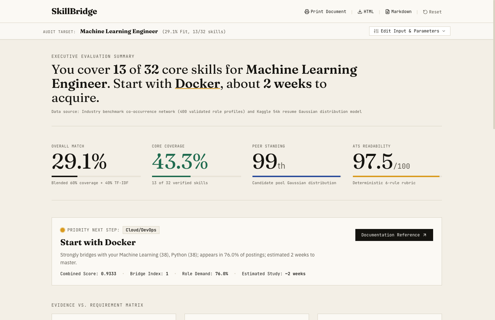
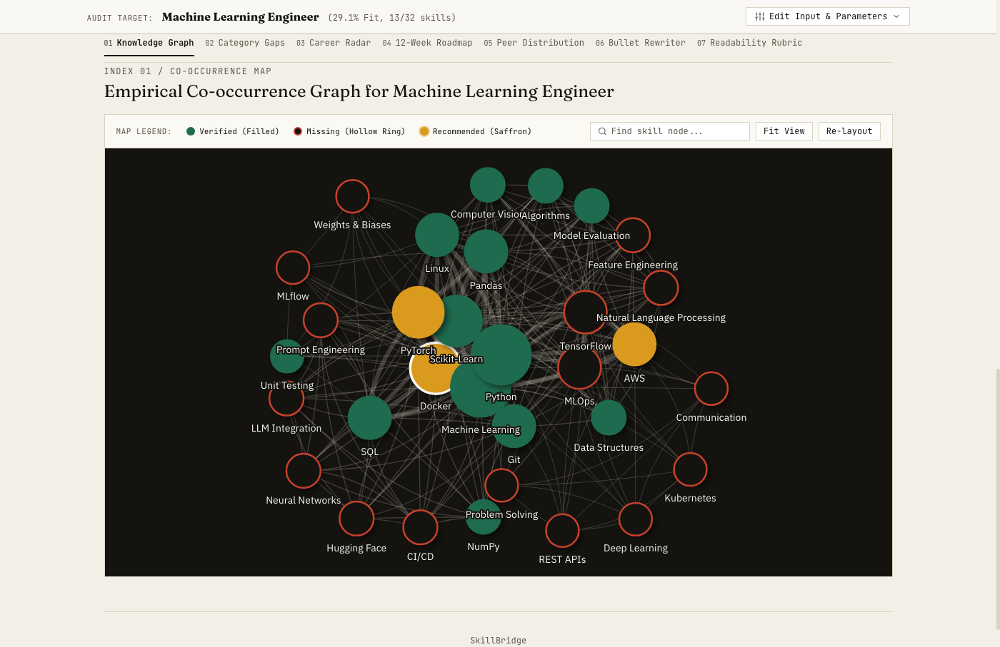
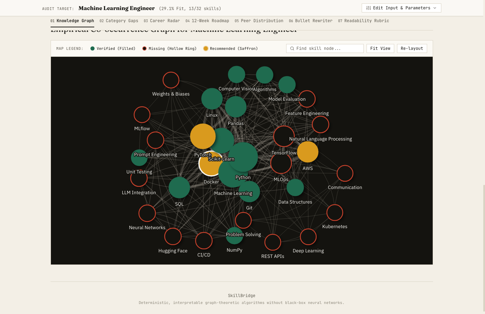
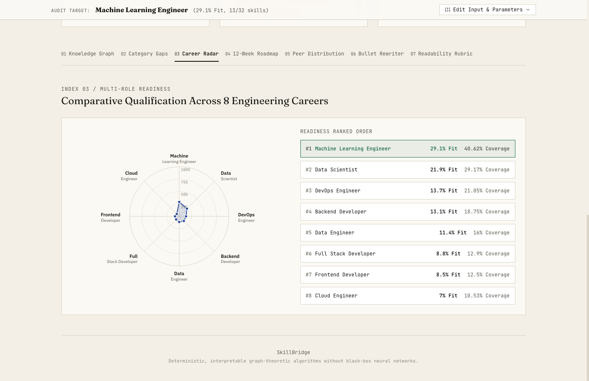
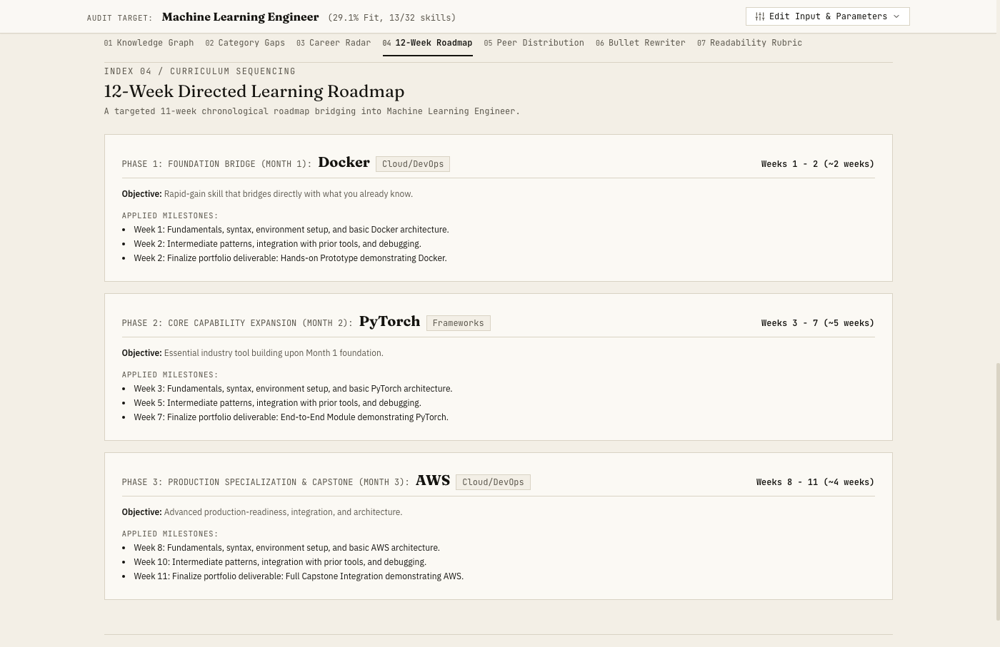
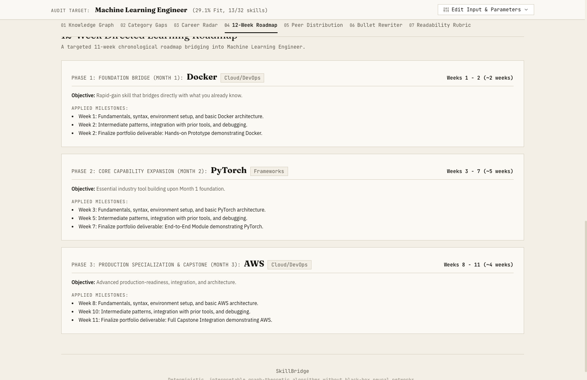
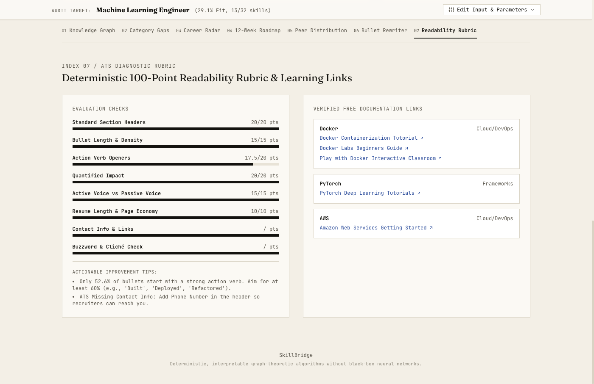

# SkillBridge 🌉
### Graph-Theoretic Career Path & Skill-Gap Analysis Platform

[](https://www.python.org/downloads/)
[](https://fastapi.tiangolo.com)
[](https://react.dev)
[](https://vitejs.dev)
[](https://tailwindcss.com)
[](https://visjs.org)
[]()
[](LICENSE)

**SkillBridge** is an interpretable, graph-theoretic career advising and skill-gap auditing platform engineered to replace opaque, heuristic-driven Applicant Tracking Systems (ATS) and stochastic Large Language Model (LLM) evaluators with mathematically verifiable algorithms.

Rather than relying on black-box probabilistic models that hallucinate and yield non-reproducible scores, SkillBridge models technical proficiencies as an empirical co-occurrence network using **spaCy PhraseMatcher**, **NetworkX**, and **Sublinear TF-IDF Vector Space Modeling**.

---

## 🎯 Key Features

1. **Dual-Fit Scoring Engine**:
   - **Set Coverage Ratio ($S_{\text{coverage}}$)**: Direct intersection between candidate skills and target role core requirements.
   - **Sublinear TF-IDF Cosine Similarity ($\text{Sim}_{\text{TF-IDF}}$)**: Semantic vector similarity with logarithmic term dampening ($1 + \log(\text{tf})$) to neutralize adversarial keyword stuffing.
   - **Blended Composite**: $\text{Fit} = 0.60 \cdot S_{\text{coverage}} + 0.40 \cdot \text{Sim}_{\text{TF-IDF}}$.
2. **Interactive Co-Occurrence Knowledge Graph**:
   - Embedded native **Vis.js Network** canvas on an obsidian surface (`#14130F`).
   - High-contrast 4px boundary strokes ensuring 100% label legibility without hover interaction.
   - Color & shape coding:
     - 🟢 **Filled Green**: Verified matched skills.
     - 🔴 **Hollow Vermilion Ring**: Missing role requirements (gaps).
     - 🟡 **Saffron Ringed Node**: Top recommended "next-best skill".
   - Stabilized Barnes-Hut physics simulation with zero continuous CPU drain.
3. **Multi-Objective Next-Best-Skill Optimization (Pareto Solver)**:
   $$\text{Score}(M) = w_1 \cdot C_{\text{norm}}(M) + w_2 \cdot D_{\text{norm}}(M) + w_3 \cdot \text{Ease}_{\text{norm}}(M)$$
   - Dynamically balances **Bridge Connectivity** ($w_1$), **Market Demand** ($w_2$), and **Learning Speed** ($w_3$).
   - Topological **Breadth-First Search (BFS)** graph shortest-path distance tiebreaker.
4. **All-Roles Career Readiness Leaderboard & 8-Axis Radar**:
   - Simultaneously benchmarks candidate qualification across all 8 canonical engineering archetypes.
   - Custom hand-crafted SVG 8-axis radar polygon.
5. **Directed 12-Week Study Roadmap**:
   - Chronologically sequences missing competencies into three phases: *Foundational Core*, *Framework & Architecture*, and *Production Tooling*, complete with official documentation links.
6. **Gaussian Peer Percentile Benchmark (54k Applicant Pool)**:
   - Projects candidate readiness onto an empirical normal distribution ($\mu = 58.2, \sigma = 14.7$).
   - Calculates exact standard $Z$-score and cumulative percentile via the Gaussian error function $\text{erf}(Z)$.
7. **Google XYZ Bullet Point Impact Rewriter**:
   - Detects passive, unquantified statements and transforms them into Laszlo Bock's high-impact standard: *"Accomplished [X] as measured by [Y], by doing [Z]"*.
8. **Deterministic 100-Point ATS Resume Rubric**:
   - Audits resumes across 6 objective criteria: Section Headers (20 pts), Bullet Length $\le 25$ words (20 pts), Action Verbs $\ge 5$ (20 pts), Quantifiable Metrics $\ge 3$ (20 pts), Passive Voice Avoidance (10 pts), and Length Economy 250–800 words (10 pts).
9. **Editorial "Warm Paper Field Guide" Visual Design**:
   - Restrained, academic aesthetic inspired by scientific atlases (`#F3EFE6` paper, `#14130F` ink, `#D9D3C4` hairline rules).
   - Self-hosted offline typography using `@fontsource/fraunces`, `@fontsource/ibm-plex-sans`, and `@fontsource/jetbrains-mono`.
10. **One-Click Executive Report Export**:
    - Exports print-ready HTML documents with `@media print` pagination and raw Markdown audits.

---

## 🏗️ System Architecture

```
                      +---------------------------------------------------+
                      |            CLIENT TIER (React 18 SPA)             |
                      |  - App.jsx                     - Vis.js Canvas    |
                      |  - SVG Radar & Bell Curve      - Offline Fonts    |
                      +-------------------------+-------------------------+
                                                | HTTP REST (JSON / Multipart)
                                                v
                      +---------------------------------------------------+
                      |             API ROUTING TIER (FastAPI)            |
                      |  - GET  /api/roles             - POST /api/analyze|
                      |  - Static Mount (/)            - HTML/MD Export   |
                      +-------------------------+-------------------------+
                                                |
                                                v
                      +---------------------------------------------------+
                      |          CORE ALGORITHMIC PIPELINE ENGINES        |
                      |  1. File Ingestion (PyPDF2, python-docx, UTF-8)   |
                      |  2. spaCy PhraseMatcher & 120+ Alias Resolution   |
                      |  3. NetworkX Co-occurrence Graph Builder          |
                      |  4. Dual-Fit Scorer (Set Coverage + TF-IDF)       |
                      |  5. Multi-Objective Pareto Recommender + BFS      |
                      |  6. 12-Week Roadmap & Gaussian Peer Benchmark     |
                      |  7. 100-Point ATS Auditor & XYZ Bullet Rewriter   |
                      +---------------------------------------------------+
```

---

## 📊 Results & Screenshots

| Main Application Input | Executive Summary & Matrix |
| :---: | :---: |
|  |  |

| Interactive Knowledge Graph | Category Breakdown |
| :---: | :---: |
|  |  |

| Career Readiness Radar | 12-Week Study Roadmap |
| :---: | :---: |
|  |  |

| Gaussian Peer Distribution | 100-Point ATS Rubric |
| :---: | :---: |
|  |  |

---

## 🚀 Quickstart Guide

### Prerequisites
- Python 3.9, 3.10, or 3.11
- Node.js v18+ & npm (for frontend builds)

### 1. Clone the Repository
```bash
git clone https://github.com/<your-username>/SkillBridge.git
cd SkillBridge
```

### 2. Environment Setup & Installation
```bash
# Create and activate Python virtual environment
python3 -m venv .venv
source .venv/bin/activate

# Install Python backend dependencies
pip install -r requirements.txt
pip install uvicorn fastapi python-multipart httpx

# Download spaCy lightweight model
python -m spacy download en_core_web_sm

# Build production frontend
cd frontend
npm install
npm run build
cd ..
```

### 3. Run Automated Unit Tests (28 Tests)
```bash
pytest tests/
# ======================== 28 passed in ~8.90s ========================
```

### 4. Launch Application
```bash
./run_app.sh
```
Open **[http://localhost:8000](http://localhost:8000)** in your browser.

---

## 🔌 REST API Specification

### `GET /api/roles`
Returns all 8 canonical target roles and default objective weights ($w_1, w_2, w_3$).

### `POST /api/analyze`
Accepts `multipart/form-data`:
- `resume_file`: (Optional) PDF, DOCX, or TXT file.
- `resume_text`: (Optional) Plain text resume.
- `target_role`: Target role name (e.g. `"Machine Learning Engineer"`).
- `custom_job_description`: (Optional) Custom job posting text.
- `w1`, `w2`, `w3`: (Optional) Floats summing to 1.0.

Returns structured JSON evaluation: summary scores, matched/missing skills, category breakdown, recommendations, leaderboard, roadmap, ATS audit, and graph nodes/edges.

### `POST /api/export/html` & `POST /api/export/markdown`
Generates standalone print-ready HTML documents and raw Markdown career audits.

---

## 🛡️ License
Distributed under the MIT License. See `LICENSE` for more information.
